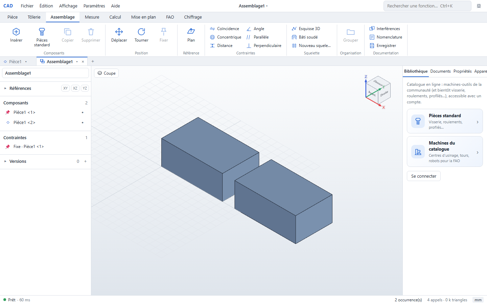

# Solidus

**Simple, fast and open source** mechanical CAD software, available:
- **in the browser** (kernel compiled to WebAssembly);
- **as a desktop application** (Windows and Linux, via Tauri; macOS is untested).

Each workbench is an independent module. Third-party plugins can extend the software.

[](docs/media/solidus-presentation.mp4)

*Solidus in 30 seconds: [watch the video](docs/media/solidus-presentation.mp4).*

The full version you can download adds proprietary modules on top of this core (see below).

What comes next is in [ROADMAP.md](ROADMAP.md).

## What Is Open, What Is Not
| Component | Status | License |
|---|---|---|
| Kernel (`core/`, `packages/kernel-*`), sketcher, viewer, web and desktop application | **This repository, open** | AGPL-3.0 with the [Solidus Plugin Exception](LICENSES/AdditionRef-Solidus-Plugin-Exception.txt) |
| Part, Sheet metal, Assembly and Tools (measure, mass properties, liaison graph) workbenches, Gears module (`modules/gears`: spur and helical gears, racks, bevel gears), Motion module (`modules/motion`: motion studies, collisions, video export) | **This repository, open** | AGPL-3.0 with the Plugin Exception |
| SDK (`packages/sdk`) | **Open**: anyone can write a plugin | MIT |
| Drawing, Weldments, CAM, Structures and FEM analysis, Quoting, Surfaces, Flow, pipe / cable routing, utilities (belts, buckling, tolerance stacks), AI assistant and MCP server, additional themes | Separate modules, **private**; plugged in through the extension points of `apps/web/src/host.ts`. The kernel operations and SDK types they rely on (surfaces, frames, drawing data) are in this repository | Proprietary |
| Online parts library, account, licenses and editions, desktop updates, library server | **Private** | Proprietary |

## Which Version to Use
> **Beta**: Solidus is at an early stage. Features arrive progressively and bugs are to be expected.

**Use the full version.** The full version (the official installers and app.solidus-cad.com) contains everything: this open
core plus the drawing, weldments and the other modules, the online parts library and automatic updates.

- **Non-commercial use** (personal projects, education, associations, open hardware): the full version is **free**.
- **Commercial use**: free for individuals, freelancers, associations and companies up to €350k in annual revenue,
  group included (drawing annotations, Motion and Flow need a free account); above that threshold, a per-seat
  subscription or a perpetual license. Support and onboarding are available for companies. See [solidus-cad.com](https://solidus-cad.com).

The open core in this repository is meant for those who want to read, audit, modify or extend the software. Each
[release](https://github.com/solidus-cad/solidus-core/releases) also provides installers built from this repository
alone (part, sheet metal, assembly, Motion, light and dark themes with three accents; no account, no network calls),
next to those of the full version.

## Official Builds and Building From Source
The installers and the web application published by Copo Software (app.solidus-cad.com) are **complete builds**: this
open core plus the private modules (drawing, weldments, online library and account, licenses, additional
themes, automatic updates, error reports and usage statistics under opt-in consent).

This repository builds on its own into a complete, usable modeller: sketch, part, sheet metal, assembly, Motion and tools,
STEP, STL, OBJ, 3MF and DXF exchange, local files and plugins. Everything in it is unlocked: no account, no license,
no network calls (only a plugin granted a `network:` permission can reach the domain it declared). The private modules are not needed to build, run or test it; they plug into the core at build time
(`CAD_EXTENSIONS`, see [docs/MODULES.md](docs/MODULES.md)), and a build without them simply does not show their
workbenches.

### Prerequisites
- Node.js 22 or later, and pnpm 9 (`corepack enable`).
- For the desktop application: Rust (rustup) and the [Tauri prerequisites](https://tauri.app/start/prerequisites/) of your platform.
- To rebuild the geometric kernel (optional): CMake, Ninja and Emscripten (web) or a C++ compiler (desktop), see [core/README.md](core/README.md).

### Web Application
```sh
pnpm install
pnpm dev          # web application at http://localhost:5173 (needs the kernel, see below)
pnpm build        # production build in apps/web/dist
pnpm test         # unit tests (SDK, real OCCT kernel)
pnpm typecheck    # type checking of all packages
pnpm test:e2e     # end-to-end tests in Chromium (Playwright)
```
The application needs the WebAssembly kernel in `packages/kernel-wasm/dist/`. The quickest way is to download the
precompiled one of the release pinned in `tools/kernel-version.json` (checked against its SHA-512):
```sh
node tools/fetch-kernel.mjs
```
After a change in `core/`, compile it yourself instead (Emscripten, CMake, Ninja; OCCT alone takes several tens of
minutes):
```sh
tools/build-occt.sh wasm
tools/build-kernel.sh wasm
```

### Desktop Application
```sh
tools/build-occt.sh native && tools/build-kernel.sh native   # native kernel (cad-kernel), next to the application
pnpm desktop:dev                        # development
pnpm desktop:build                      # local installer (NSIS on Windows, .deb and AppImage on Linux)
```
Installers built from this repository have no automatic updates. Settings of the installed application (proxy,
language): [cad.config.toml](cad.config.toml). See [apps/desktop/README.md](apps/desktop/README.md).

To contribute: [CONTRIBUTING.md](CONTRIBUTING.md) (Contributor License Agreement, [CLA.md](CLA.md)). Security: [SECURITY.md](SECURITY.md). Name and logo: [TRADEMARK.md](TRADEMARK.md).

## Project Status
Solidus is at an **early stage** (beta): expect bugs, missing features and changes from one version to the next. New
features and workbenches arrive progressively, in both the full version and this open core. Bug reports are welcome
(issues of this repository, or Help › Report a bug in the application).

No backward compatibility is guaranteed yet: files and features of an older version may break.

## License
This repository is licensed under the **GNU Affero General Public License v3.0** ([LICENSE](LICENSE)) with the
[Solidus Plugin Exception](LICENSES/AdditionRef-Solidus-Plugin-Exception.txt): plugins that use only the SDK and run in
the sandbox may use any licence. The SDK (`packages/sdk`) is licensed under MIT. Files created with Solidus belong to
their authors. Third-party components are listed in [THIRD_PARTY_LICENSES](THIRD_PARTY_LICENSES). The name "Solidus"
and its logo are not covered by these licences ([TRADEMARK.md](TRADEMARK.md)).

## Support the Project
If Solidus is useful to you, you can support its development:

<a href="https://buymeacoffee.com/solidus_cad"></a>

[buymeacoffee.com/solidus_cad](https://buymeacoffee.com/solidus_cad)
